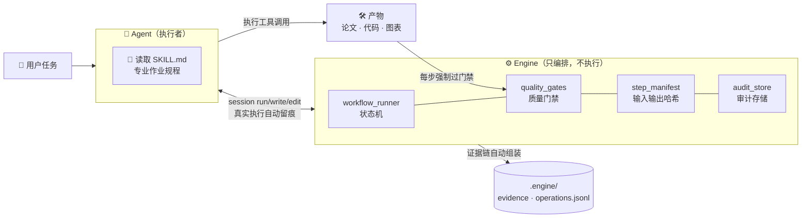

<div align="center">

# ⚗️ Academic Agent Toolkit

### 让 Agent 像科研人员一样工作

*263 个随仓技能 · 6 大能力域 · 宿主无关引擎 · 每一步产物可审计*

[](./CHANGELOG.md)
[](academic-toolkit/tests)
[](capabilities/catalog.json)
[](academic-toolkit/skills)
[](./LICENSE)
[](#快速开始宿主无关)
[](#快速开始宿主无关)

</div>

---

> [!TIP]
> **一句话**：把一件事交给它——一道数模赛题、一个研究课题、一份课程作业、一篇待投稿论文、一批待出图的资料，
> 或一份软著／专利／基金申请材料——它按专业作业规程（263 个随仓技能）自主走完
> **检索 → 建模／实验 → 编码 → 绘图 → 写作 → 自评 → 审稿 → 编译 → 交付审计**；
> 每一步的产物可复现、可审计、可追溯，并按真实评分维度被测量。

它既不是提示词合集，也不是某个大模型的套壳：**技能是知识，引擎是记忆，执行者是 Agent**——三者分开，才谈得上"每一步可复现"。

## 🔁 一次任务从进到出

| 阶段 | 谁在做 | 发生了什么 |
|------|--------|-----------|
| ① 领规程 | Agent | 读 `skills/<name>/SKILL.md`——一份**可执行的专业作业规程**（工具调用、输出契约、质量标准），读完自主执行，不必等逐步指令 |
| ② 领任务 | 引擎 | `workflow_cli next` 给出本步技能正文与会话；`session run/write` 真实执行，操作自动留痕、依赖自动复用 |
| ③ 过门禁 | 引擎 | 页数、伴随文件、产物哈希、论文一致性、图-文叙述、AI 味、九维评分——不达标在成稿前打回改稿，而不是交付后才发现 |
| ④ 一次验收 | 引擎 | `session finish` 时从持久操作记录**机械组装**证据（命令、字节快照、资源哈希、依赖）——执行者不为"证明做过"额外生产任何东西 |
| ⑤ 交付审计 | 引擎 | L2 编排留痕与 L3 执行申报交叉比对，"伪造审核产物"无从落地 |

## ✨ 为什么不是又一个提示词合集

<table>
<tr><td width="50%" valign="top">

#### 🧠 技能即知识
每个 `skills/<name>/SKILL.md` 是一份可执行的专业作业规程——含工具调用、输出契约、质量标准。Agent 读完后自主判断与执行，而非等人喂逐步指令。

</td><td width="50%" valign="top">

#### ⚙️ 引擎只编排
`engine/` 是状态机不是执行者：workflow 状态推进、质量门禁、STEP_MANIFEST 溯源、审计存储。**执行永远在 Agent，记忆永远在引擎**；完成步骤的证据由引擎从真实操作自动组装，模型零手填。

</td></tr>
<tr><td width="50%" valign="top">

#### 🎯 门禁对准产出
页数、伴随文件、产物哈希、九维评分——门禁检查的是"这份论文/报告能不能得分、能不能被复算"，不是"流程有没有走完"；不达标在成稿前就被打回。

</td><td width="50%" valign="top">

#### 🔍 三层审计
L1 拦截式审计在**可选**宿主适配器（OpenCode 插件 / ZCode hook）就位时逐条记录工具调用；无宿主 hook 时 L1 如实降级为 unavailable。L2 编排留痕 + L3 执行申报始终可用，交叉比对让"伪造审核产物"无处遁形。

</td></tr>
</table>

## 🗺️ 六大能力域 + Agent 运行时 · 321 项能力

| | 能力域 | 条目 | 代表能力 |
|--|--------|-----:|----------|
| 🎓 | **课程与研究材料** | 88 | 课程论文 · 实验报告 · 教学大纲 |
| 📝 | **学术论文** | 75 | 写作 · 评审 · 润色 · 投稿准备（含 Nature 工作流） |
| 🔬 | **文献与研究** | 41 | 文献检索 · 综述 · 深度研究 · 实验设计 |
| 🏆 | **数模竞赛** | 38 | CUMCM / 华为杯 14 步端到端流水线 · 23 赛事档案 |
| 📊 | **图表与文档生产** | 64 | 期刊级科研绘图 · 信息图 · LaTeX |
| ©️ | **知识产权材料** | 12 | 软著 · 专利 · 基金申请书 |
| 🧩 | **Agent 运行时** | 3 | 宿主无关自举 · 自适应工具铸造 · 候选交付复现 |

> 域表与 `capabilities/catalog.json` 对齐：88/75/41/38/64/12/3 = **321**（与徽章一致）。

> [!NOTE]
> **技能计数口径**（唯一）：徽章与正文统一为 `git ls-files` 口径的技能 SKILL.md 数（**clone 即所见**，现行 **263**）；数字由 `tools/sync_baselines.py` 单源传播，不再手工多处同步。

<details>
<summary><b>📊 科研绘图栈（v1.1 新扩展，9 个上游技能）</b></summary>

<br>

| 层 | 技能 | 能做什么 |
|----|------|----------|
| 期刊规范 | `scientific-visualization` | 多面板布局 · 误差棒 · 显著性标注 · 色盲安全 · PDF/EPS/TIFF 导出 |
| 绘图库 | `matplotlib` `seaborn` `plotly` | 底层定制 · 统计图形 · 交互式图表 |
| 确定性图 | `fig-spec` `graphviz` `mermaid-diagram` | JSON→SVG 架构图 · 依赖图 · 流程图 |
| 编辑级图 | `diagram-design` | 39 类品牌图（Sankey/鱼骨/Wardley/UML/ER…）· 重绘 drawio/mermaid 源 · MIT |
| 视觉论证 | `excalidraw-diagram` `infographics` `scientific-schematics` | 手绘风论证图 · 信息图 · 科学示意图 |
| 既有沉淀 | `paper-figure-nature` + 62 篇获奖论文实证规范 | Nature 级排版与配色 |

全部集成带 **pinned-commit 溯源**（`UPSTREAM.md` 台账 + vendor，`tools/check_provenance.py` 一键校验 117/117）。

</details>

## 🔄 最近更新（2026-10）

- **引擎层（10-23~24）**：交付候选冻结 + 候选批准 guard + 候选事件哈希链 + 复现路径短段化（Windows 长路径适配）——"候选"从口头承诺变成可校验的冻结物。
- **产出效果（10-23 四批）**：九维评分卡前移到初稿步并被 `comp-editor` 消费 · 21 条短赛事链补齐 6 个收口步骤 · 写作分片（单步开工载荷峰值 −63%）· 出图样式收敛到 `academic.mplstyle` 单一真源（R 侧有对等规范）· 创新链接入获奖语料方法频次表（26 类方法 / 457 篇）。
- **工程卫生**：基线数字单源化（`tools/sync_baselines.py`）· 死产物清理 · 1.47 GiB 实验原始数据转仓外冷存（哈希溯源链不断）。

逐批细录见 [CHANGELOG.md](./CHANGELOG.md)；诊断与执行报告存于项目内部文档（不分发）。

## 🏗️ 架构



> 完成一步只需 `session finish` 一次验收：证据（命令、字节快照、资源哈希、依赖）由引擎从持久操作记录**机械组装**，
> 门禁与终审在引擎内一次跑完——执行者不为"证明做过"而生产任何东西。

## 🚀 快速开始（宿主无关）

**任何能读文件、能执行 Python CLI 的 Agent 都可以驱动本项目**——Claude Code / Cursor / Gemini CLI / MiMo Desktop / OpenCode / ZCode / 自写脚本。

```bash
git clone https://github.com/FOURTEEN1416/academic-agent-toolkit.git
cd academic-agent-toolkit
python -m pip install -r requirements-dev.txt   # 第 0 步：测试/门禁依赖（在仓库根跑，别先 cd 进子目录）
cd academic-toolkit
python -m engine.workflow_cli boot
python -m engine.workflow_cli probe
```

1. 读仓库根 `AGENTS.md` 与 `academic-toolkit/AGENTS.md`
2. `boot` 取得驱动契约；`probe` 查看能力与 TOOL_GAP
3. 缺工具时 `python -m engine.workflow_cli forge --tool <name> --purpose "..."`
4. 竞赛/长流程：`start --template comp_cumcm` → `next`（自动给本步技能正文与会话）→ `session run --session FILE --plan PLAN --finish`（真实执行自动留证、依赖复用、一次验收与推进；需批准时仍暂停）
5. 单技能：按路由表读 `skills/<name>/SKILL.md`（根 `AGENTS.md` §三 有高频意图直达表）

自举：`academic-toolkit/skills/agent-bootstrap/` · 铸造：`academic-toolkit/skills/tool-forge/`
适配器：协议不依赖；需要适配器元数据时 `python -m engine.workflow_cli forge --adapter <name>` 本地生成

> [!IMPORTANT]
> **路径卫生（PUBLIC 仓）**：tracked `opencode.json` 的 MCP `command` 与 `DOCSEARCH_ROOTS` 使用**可移植占位符**（`${DOCSEARCH_MCP_SERVER}` / `${DOCSEARCH_ROOTS}`）。docsearch MCP 装在宿主用户目录时，**操作员须在本地设置未提交的覆盖**；勿将 `C:\Users\...`、过期项目根路径写回 tracked 文件。宿主本地配置一律不入库。

直接下任务（任意 Agent）：

> "按 CUMCM 流程做这道 2024 年 B 题，数据在 data/ 下，输出国一格式论文。"

### 可选宿主适配器

| 适配器 | 用途 |
|--------|------|
| **OpenCode Desktop** | 打开仓库根即可用 `opencode.json`（默认角色数模专家 + skills 扫描 + subagent 内联）。**不依赖 `opencode` CLI** |
| **ZCode** | `cmd /c "mklink /J .zcode\skills academic-toolkit\skills"` 后打开仓库根；L1 hook 按本地未提交配置注册（契约见 `academic-toolkit/tests/test_zcode_host_compat.py` D 段） |
| **其他** | 无需专用配置，按上文协议驱动；需要适配器元数据时 `python -m engine.workflow_cli forge --adapter <name>` 本地重建 |

### 环境要求

| 级别 | 组件 | 用途 | 安装 |
|------|------|------|------|
| 必装 | Python 3.11+ | 全部能力 | python.org |
| 必装 | Python 依赖包 | 测试与门禁（pytest / pypdf / ruff 等） | `python -m pip install -r requirements-dev.txt`（**在仓库根执行**；ruff 版本锁死，勿单独升级） |
| 必装 | TeX Live / XeLaTeX | 论文编译类能力 | texlive.org |
| 推荐 | Graphviz（`dot`） | `graphviz` 技能 | `winget install --id Graphviz.Graphviz -e` |
| 推荐 | mermaid-cli（`mmdc`） | `mermaid-diagram` 技能 | `PUPPETEER_SKIP_DOWNLOAD=true bun install -g @mermaid-js/mermaid-cli`（用系统 Edge/Chrome 需写 puppeteer 配置，见技能内说明） |
| 可选 | **多模态 LLM 图像生成后端** | `infographics`、`scientific-schematics` 两个 AI 绘图专属技能 | `export OPENROUTER_API_KEY=sk-...` 或宿主原生 `generate_image` 后端；质量评审四角色已按 2026-09-26 用户裁定改配宿主窗口/视觉通道（`engine/modex-core/contest_models.json`，外部 Agnes 通道 2026-09-23 退役） |

> [!IMPORTANT]
> **AI 绘图技能（infographics / scientific-schematics）必须有多模态 LLM 图像生成后端**——技能内置 Step 0 强制检测，缺后端会明确报错并给指引，不会用占位图冒充。其余绘图技能全部本地运行、零 API。

**一键体检**（本机能用哪些绘图技能、缺什么、怎么装）：

```bash
python academic-toolkit/tools/plotting_env_check.py
```

**验证安装**（两种 pytest 口径，唯一真源 = `pytest.ini` 注释）：

```bash
# 口径一（仓库根，回归门禁口径）：1362 collected；最近全量实跑记录见 pytest.ini
python -m pytest -q
# 口径二（工具箱内，技能验收基线口径）：同一 tests 范围
cd academic-toolkit && python -m pytest -q
python tools/check_provenance.py             # → 117/117 UPSTREAM+vendor 台账通过
```

## 🛡️ 质量与可信

| 机制 | 一句话 |
|------|--------|
| 🚧 **命名门禁（16 项）** | `paper_consistency` · `citation_integrity` · `experiment_reproduc` · `figure_provenance` · `figure_narrative` · `compilation_log` · `ai_flavor` · `step_manifest` · `modeling_contract` · `review_rounds` 等，注册表在 `engine/gates/quality_gates.py`，技能正文可声明、模板步可挂载 |
| 🎯 **九维评分** | 初稿步产出每维 0-5 分 + 正文/图/表位置证据 → 编辑按失分清单改稿 → 终审复核闭环（模型贴合/验证强度/差异化合计 0.35 权重不再缺席） |
| 🧾 **STEP_MANIFEST** | 每步记录输入/输出哈希、命令、配置、依赖——产物可复现 |
| 📜 **Provenance 台账** | UPSTREAM.md + vendor（pinned commit + license）117/117 校验通过——外部集成的每一行代码都能回答"从哪来" |
| 🎯 **私有基准层** | 真实竞赛题面基准仅本地私有，不入库、不随仓库分发 |
| ✅ **测试基线** | 仓库根 **1362 collected**；**唯一真源 = `pytest.ini`**，数字由 `tools/sync_baselines.py` 单源传播（`--check` 比对 / `--accept` 回写），不再手工多处同步。它是防静默丢测试的漂移锚点，不是完成验收证据 |
| 🧩 **逐技能登记** | 技能 100% 登记 catalog 映射（schema 硬校验；含 agent-bootstrap / tool-forge 宿主无关能力）；真实执行证据为主，外部依赖项诚实标注 blocked-by-dependency，零伪造 |
| 🧩 **宿主无关协议** | `workflow_cli boot/probe/forge` + 宿主适配器（可选）+ TOOL_GAP→工具铸造 |

## 📁 仓库地图

```
academic-agent-toolkit/
├── academic-toolkit/     ★ 产品主体：skills · engine · execution · tools · tests
│   └── third_party/      五个内嵌第三方引擎（pinned commit + UPSTREAM.md 溯源）
├── capabilities/         能力目录 catalog.json（321 项，技能 100% 映射）
├── assets-local/         随仓参考资料区：获奖论文语料（部分子集本地保留）· 赛事官方原件 · 版面蒸馏卡
├── vendor/               上游 fork 收编（pinned commit + UPSTREAM.md 溯源，与 third_party 合计 117 项）
├── SECURITY.md           安全策略与漏洞上报
├── AGENTS.md             Agent 入口：宿主无关驱动协议 + 适配器矩阵
├── pytest.ini            测试口径唯一真源（含防漂移基线锚点）
└── CHANGELOG.md          版本记录
```

<details>
<summary><b>🔖 版本与许可证</b></summary>

<br>

**未发布批（2026-10-23~24）** —— 整仓升级四批（九维评分卡前移并被编辑消费、21 条短赛事链补齐收口、comp-paper-zh 写作分片 −63%、出图样式收敛单一真源含 R 侧对等规范、method-map 12 张方法落地卡、novelty_checker 单调化 + 方法频次表、死产物清理 + 1.47 GiB 实验原始数据冷存、基线单源化；终态实测 1089 passed / 0 failed）+ 引擎层 G2/G4 三批（交付候选冻结、候选批准 guard、候选事件哈希链、复现路径短段化）。详见 [CHANGELOG.md](./CHANGELOG.md)。

**v2.1.0（2026-09-27）** —— 赛事档案 v2 隔离：`comp_rules.json` 升级 schema v2 并切生产（22 赛事 / 8 profile / 51 约束 = 36 verified + 15 unknown）· 规则选档接口（`contests[id].profiles[]` 按 edition/submission_form + region/stage 精确选择，禁用模糊回落）· `contest_profile.py` v2 解析器与 execution 受控缓存 · 命令环境注入 `CONTEST_ID`/`PAGE_CAP`/`PAGE_SCOPE`/`PAGE_CAP_STATUS`/`EDITION`（智能体不再转录）· 技能正文与模板对齐。修复跨赛事规则混用与 P1 假绿；详见 [CHANGELOG.md](./CHANGELOG.md)。

**v2.0.0（2026-09-23）** —— 整仓彻底重构：套件目录 `科研工具箱/`→`academic-toolkit/` · 技能命名法（139 件改名 + 9 对真重复合并）· 资产激活机制（asset_catalog 台账 + boot/probe/bootstrap 资产暴露 + 三方对账）· 私有资料区统一 `assets-local/` · 第三方子项目独立 `third_party/` · 上游 fork `vendor/forks/` · 内容融入（287 自查表 / 范文包 / 板块提示词 / 88 色板）· 新增 `award-paper-mining`。**破坏性变更**，迁移指引见 [CHANGELOG.md](./CHANGELOG.md)。

**v1.3.0（2026-09-22）** —— 宿主无关协议（boot/probe/forge + agents/adapters）· 基线基础设施加固（secret_scan / lint_ratchet / duplicate_assets / 工具冒烟闸 + CI 加固）· 系统性升级五项 · 华为杯管线补齐（与国赛同构 14 步）· 四批并行收编。

**v1.2.0（2026-08-30）** —— 三条学术管线 C2 闭环 · 科研绘图域闭环。完整记录见 [CHANGELOG.md](./CHANGELOG.md)。

| 范围 | 许可证 |
|------|--------|
| 仓库核心（技能/工具/引擎/配置） | [CC-BY-NC-4.0](./LICENSE)（+ 附加限制：禁商用 · 禁 AI 训练） |
| Vendored 第三方组件 | 随各自许可证，见各目录 `UPSTREAM.md` / `LICENSE` |

</details>

## 🙏 致谢

本项目的科研绘图与学术能力站在这些优秀开源项目的肩膀上（均为 pinned-commit 集成）：
[K-Dense-AI/scientific-agent-skills](https://github.com/K-Dense-AI/scientific-agent-skills) ·
[foryourhealth111-pixel/Vibe-Skills](https://github.com/foryourhealth111-pixel/Vibe-Skills) ·
[synthetic-sciences/openscience](https://github.com/synthetic-sciences/openscience) ·
[wanshuiyin/Auto-claude-code-research-in-sleep](https://github.com/wanshuiyin/Auto-claude-code-research-in-sleep) ·
[cathrynlavery/diagram-design](https://github.com/cathrynlavery/diagram-design) ·
[markdown-viewer/skills](https://github.com/markdown-viewer/skills) ·
[coleam00/excalidraw-diagram-skill](https://github.com/coleam00/excalidraw-diagram-skill) ·
[fanbuz/codesucker](https://github.com/fanbuz/codesucker)

---

<div align="center">

**联系方式**

[](tencent://message/?uin=1991401843)
[](https://github.com/FOURTEEN1416)

*如果这个项目对你有帮助，欢迎 ⭐ Star*

</div>
