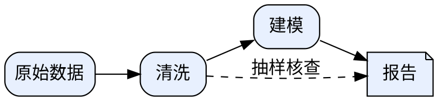

# Graphviz — relationship diagrams from DOT text

把"谁连接谁"写成几行 DOT 文本，Graphviz 负责把节点和边排布成一张可读的图。
文本即图源：可 diff、可版本控制、改一处重新渲染，不必手工拖拽。

## 什么时候用它

图的本体是**实体之间的拓扑关系**，而不是数值或视觉风格时，选这个技能：

- 依赖树、调用图、import/继承关系、包与模块层级；
- 流水线 DAG、审批链路、实验流程的状态转移；
- 证据链路、因果关系草图（论文 rebuttal / 审计叙事里常见）；
- 任何"节点 + 带方向的连线"能说清、手工排版很痛苦的结构。

## 什么时候用别的技能

| 需求 | 去处 |
|------|------|
| 实验数据画折线/柱状/热图等数值图 | paper-figure |
| 需要精确控制每个元素位置、按 JSON 规格产出可编辑 SVG | fig-spec |
| 品牌化信息图、演示型图示（配色和观感优先） | diagram-design |
| 先看别人怎么画、挑参考再动手 | agent-figure-gallery |

## DOT 一分钟上手

有向图用 `digraph`，边写 `->`；无向图用 `graph`，边写 `--`，两者不可混用：



要点：

1. 一条语句声明一个节点并给属性：`clean [label="清洗"];`；
2. 边语句只管连接：`a -> b;`，边属性跟在边后面 `[label="..."]`；
3. 含空格或特殊字符的名字用双引号包住当 ID；
4. 把一组节点圈进方框用 cluster：子图名字必须以 `cluster` 开头；
5. 让若干节点同层：放进 `{ rank=same; a; b; }`。

语法细节（record 形状、HTML 表格标签、箭头样式、间距参数、排错）见
[references/syntax.md](references/syntax.md)。

## 常见坑

- **属性和边写在同一条语句**：`a[label="x"] -> b` 不是合法 DOT。属性归属性语句，边归边语句。
- **cluster 忘写前缀**：`subgraph stage1` 只是一组节点，`subgraph cluster_stage1` 才画框。
- **HTML 标签没引号**：`label=<B>粗体</B>` 必须整体写成带引号的 HTML 字符串形式（见 syntax.md）。
- **渲染报错先看行号**：dot 的报错会指到具体行，通常是漏引号、漏分号、括号不配对三样。

## 渲染

```bash
dot -Tpng diagram.dot -o diagram.png    # 论文插图建议 -Tsvg 或 -Tpdf（矢量）
```

Windows 下 `dot` 常不在 PATH（安装器默认不勾选加入 PATH），先探测：

```bash
DOT=$(command -v dot || echo "/c/Program Files/Graphviz/bin/dot.exe")
"$DOT" -V
```

两处都找不到说明 Graphviz 未安装：`winget install --id Graphviz.Graphviz -e`，
或重跑安装器勾选 "Add Graphviz to PATH"。

## 交付前自检（dot_check 门禁）

`scripts/dot_check.py` 是本技能自带的机检门禁（纯标准库，随技能拷走即可用），
把 DOT 常见错误拦在交付前，并可真实渲染核对结构化期望：

```bash
python scripts/dot_check.py diagram.dot                          # 静态检查（无需装 graphviz）
python scripts/dot_check.py diagram.dot --render                 # 静态 + 渲染 SVG
python scripts/dot_check.py diagram.dot --render --format pdf --out fig.pdf
python scripts/dot_check.py diagram.dot --render --expect expect.json   # 核对节点/边数与关键文案
python scripts/dot_check.py --lint-dir assets/templates          # 批量检查
python scripts/dot_check.py --self-test --render                 # 技能自检（含模板与示例实渲染）
```

静态检查覆盖：引号/括号不配对、有向图用 `--` 或无向图用 `->`、
`a[label="x"] -> b` 这类属性边混写、HTML 标签裸写 `label=<B>..</B>`
（新版 graphviz 实测报错，应写 `label="<...>"` 或 `label=<<...>>`）。
渲染门禁定位 dot 的顺序：`--dot` 参数 > 环境变量 `GRAPHVIZ_DOT` > PATH >
Program Files 标准安装位（Windows 安装器默认不进 PATH，故有兜底）。

退出码：0=通过；1=检查未过；2=环境或用法错误（找不到 dot、文件缺失）。
期望 JSON 支持 `nodes`/`edges`（与 SVG 的 `class="node"`/`class="edge"` 计数精确匹配）、
`must_contain`/`must_not_contain`（SVG 文本子串）。

## 现成模板与示例

五类核心场景各有可直接改写的 DOT 模板（`assets/templates/`，中文标签 + Windows 常用字体）：

| 模板 | 场景 |
|------|------|
| `pipeline_dag.dot` | 流水线 DAG：阶段分组框、跨组交接、质检回边 |
| `dependency_tree.dot` | 依赖树：模块/包依赖、基础件与业务层分色 |
| `call_graph.dot` | 调用图：函数调用、菱形分发节点、辅助调用不参与分层 |
| `state_machine.dot` | 状态机：起止点、自环、驳回回退 |
| `module_hierarchy.dot` | 分层架构：cluster 分层 + compound 跨层连线 |

机检示例 `assets/examples/pipeline_demo.dot` 演示"改模板 → 过门禁 → 交付"全链：
`pipeline_demo.checks.json` 声明期望（6 节点、6 边、六段关键文案），
`pipeline_demo.reference.svg` 为 Graphviz 16.0.0 参考渲染（仅供人工对照，不做逐字节比较）。
用 `--lint-dir`/`--self-test` 可一键回归全部模板与示例。

## 产出契约

交付前先跑本技能门禁：`python scripts/dot_check.py <DOT源> --render`（需要核对结构时加
`--expect <期望JSON>`），静态检查与渲染全部通过再 finish；模板改写类任务用
`--self-test --render` 一并回归模板与示例。通过执行会话运行Graphviz，声明DOT源、
渲染产物及实际依赖版本。程序记录真实命令、返回码、内容摘要和执行清单；DOT源也作为
交付物保存。图件必须有来源证据并通过figure_provenance，模型不另手填清单。

## Related Files

- [references/syntax.md](references/syntax.md) — DOT 语法速查（独立编写）
- [references/UPSTREAM.md](references/UPSTREAM.md) — 溯源记录与 clean-room 声明
- scripts/dot_check.py — 静态检查 + 渲染门禁 + 技能自检（独立编写）
- assets/templates/ — 五类核心场景 DOT 模板（独立编写）
- assets/examples/ — 机检示例与结构化期望（独立编写）
